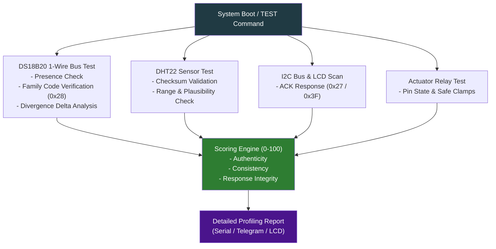

# 🩺 ESP32 Egg Incubator — Comprehensive Sensor & Hardware Testing Architecture

This document details the architecture, scoring metrics, and profiling methodologies for the **Advanced Hardware & Sensor Self-Test Subsystem** integrated into the ESP32 Egg Incubator firmware.

---

## 🏗️ System Architecture

The testing subsystem operates at two critical phases:
1. **Boot-Time Self-Test (POST):** Automatically validates all connected sensors, bus integrity, I2C peripherals, and actuator relay lines before entering the main incubation loop.
2. **On-Demand Diagnostic Suite (`TEST` / `SENSORTEST` serial command):** Runs a deep diagnostic pass across all hardware layers, outputting authenticity scores, divergence metrics, and health profiles.

---

## 📊 Scoring & Profiling Metrics (0–100 Scale)

Every sensor and hardware component is evaluated against stringent reliability engineering standards:

| Component | Profile Metric | Pass Criteria | Scoring Weight |
| :--- | :--- | :--- | :--- |
| **DS18B20 (Sensor 1 & 2)** | 1-Wire Family Code | Family byte must be `0x28` (Genuine Maxim DS18B20) | 25% |
| **DS18B20 Divergence** | Inter-Sensor Delta | $|\text{T}_1 - \text{T}_2| \le 0.5\text{°C}$ | 25% |
| **DHT22 Humidity / Temp** | Checksum & Range | Valid checksum, $0\% \le \text{Humidity} \le 100\%$, $-40\text{°C} \le \text{Temp} \le 80\text{°C}$ | 25% |
| **I2C LCD & Peripherals** | ACK Response | Device acknowledges I2C transmission at address `0x27` or `0x3F` | 25% |

---

## 🔬 In-Depth Sensor & Actuator Profiles

### 1. DS18B20 Digital Temperature Sensors (1-Wire, GPIO 4)
* **Function:** Primary precise temperature regulation for incubation ($37.7\text{°C}$).
* **Authenticity Testing:** Genuine Maxim/Dallas DS18B20 chips return `0x28` as the first byte of their 64-bit ROM address. Fake or substitute chips (e.g. parasitic variants or generic equivalents) return different family codes (e.g. `0x10` for DS18S20).
* **Divergence Analysis:** Compares Sensor 1 and Sensor 2 readings simultaneously. If their divergence exceeds $0.5\text{°C}$, a thermal gradient warning or sensor drift flag is raised.

### 2. DHT22 (AM2302) Humidity & Temperature Sensor (GPIO 15)
* **Function:** Monitors relative humidity (target ~55-65%) and secondary ambient temperature.
* **Integrity Testing:** Validates the 40-bit data packet checksum sent by the DHT22. Discards NaN or frozen readings.

### 3. Actuators & Relays (Fan GPIO 13, Turner GPIO 14, Heater GPIO 27)
* **Function:** Thermal control, egg rotation, and forced air circulation.
* **Safety Verification:** Ensures outputs adhere to hard safety clamps and detects relay stuck conditions if temperature rises while heating is commanded OFF.

### 4. I2C LCD Display (16x2, Address 0x27)
* **Function:** Local operator interface for live temperatures, health score, and cycle countdown.
* **BUS Check:** Performs an I2C bus scan (`Wire.endTransmission()`) to verify display connectivity.
